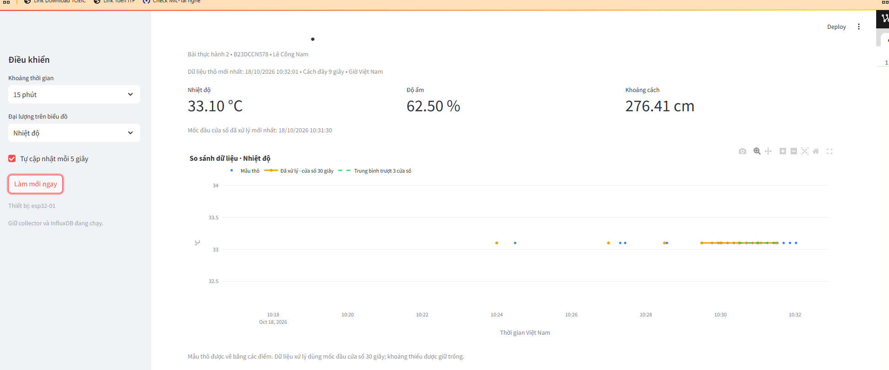

# Kết quả thực nghiệm ngày 18/10/2026

## Dữ liệu dùng để tính thời gian

`timing.csv` là bản xuất người dùng cung cấp, gồm **20** chu trình hoàn tất từ **10:03:54.864 đến 10:15:50.952 giờ Việt Nam**. Các bản ghi có `trace_id` khác nhau. Không dùng CSV này để suy ra tổng số yêu cầu hoặc tỷ lệ thành công vì file không chứa các lần quá hạn.

Để tránh trộn với thử nghiệm dừng database, chọn **15** chu trình có thời điểm nhận trước **10:11:31**. Mẫu cuối được chọn có thời điểm nhận 10:11:21.047. Ranh giới dựa trên log thực hành; không khẳng định toàn bộ lưu lượng MQTT trong khoảng đều thành công.

| Chỉ số trên 15 chu trình đã chọn | Kết quả |
|---|---:|
| Thời gian yêu cầu → xác nhận DB, nhỏ nhất | 766,5 ms |
| Thời gian yêu cầu → xác nhận DB, trung vị | 992,5 ms |
| Thời gian yêu cầu → xác nhận DB, trung bình | 2235,6 ms |
| Thời gian yêu cầu → xác nhận DB, P95 | 5068,7 ms |
| Thời gian yêu cầu → xác nhận DB, lớn nhất | 5074,2 ms |
| Thời gian lời gọi ghi dữ liệu thô, trung vị | 3,8 ms |

P95 dùng nội suy tuyến tính giữa các giá trị đã sắp xếp, tương ứng cách tính quantile mặc định của pandas. Cỡ mẫu 15 còn nhỏ, chưa đủ đánh giá độ ổn định dài hạn. Thời gian ghi DB ở đây được tính trên các bản ghi thuộc 15 chu trình, không phải toàn bộ bản tin định kỳ trong khoảng.

Chu trình yêu cầu → DB gồm cả chiều gửi yêu cầu, chờ thiết bị lấy mẫu, trả dữ liệu, hàng đợi và ghi DB. Không diễn giải thành độ trễ mạng một chiều hay thời gian sensor→DB đo trực tiếp bằng hai đồng hồ đã đồng bộ. Thử nghiệm dùng Wokwi nên tốc độ thời gian mô phỏng ảnh hưởng chu trình.

## Phục hồi sau khi dừng InfluxDB

Log cho thấy trước thử nghiệm đã ghi `seq=64`, `seq=65`. Trong lúc InfluxDB dừng, collector nhiều lần báo `WinError 10061`, giữ bản tin và thử lại. Sau khi database hoạt động, `seq=66` được ghi thành công.

Kết quả truy vấn hàng đợi do người dùng cung cấp:

```text
Tong ban tin dang cho: 0
Ban tin chua ghi du lieu tho: 0
```

Kết luận giới hạn: tại thời điểm kiểm tra, các bản tin đã vào hàng đợi đều được xử lý xong. Không đủ dữ liệu để kết luận không mất gói MQTT trong toàn bộ thử nghiệm. CSV cung cấp không có mẫu đo chu trình trong lúc database tắt, nên không đưa ra con số độ trễ phục hồi cho tình huống đó.

## Chống trùng và yêu cầu quá hạn

Sau khi gửi lại một payload cũ, collector báo:

```text
BO QUA BAN TRUNG | boot=2ccd2c551a7aad05 | seq=80
```

Đây là bằng chứng cho một lần kiểm tra phát lại trùng khóa. Các log cũng ghi nhận yêu cầu quá hạn 120 giây; không loại bỏ thông tin này khi báo cáo, và chưa tính tỷ lệ thành công do không có nhật ký đầy đủ của mọi yêu cầu.

## Lưu trữ

PowerShell đo thư mục `C:\Users\Admin\.influxdbv2` lúc thực hành: **57 tệp**, tổng kích thước logic **64,92 MiB** (lệnh chia cho hằng `1MB = 1.048.576 byte`). Số liệu là ảnh chụp tại một thời điểm khi database đang chạy; gồm dữ liệu, WAL và metadata, không phải số byte riêng của một bucket hay số byte mỗi bản ghi. Không dùng ảnh chụp này để ước lượng hệ số nén hoặc tăng trưởng theo ngày.

Retention đã cấu hình: `iot_raw` 7 ngày, `iot_processed` 30 ngày. SQLite ngoài thư mục trên chưa tự dọn bản ghi đã hoàn tất và cần chính sách riêng nếu vận hành lâu dài.

Theo cấu hình danh nghĩa, chu kỳ 5 giây tương đương 17.280 mẫu định kỳ/ngày và cửa sổ 30 giây tương đương 2.880 cửa sổ/ngày/thiết bị. Đây là phép tính lịch lý tưởng, không phải số đo thực tế: Wokwi có thể chậm/dừng, kết nối có thể gián đoạn và yêu cầu đo có thể làm thay đổi lịch lấy mẫu.

## Dashboard và tiền xử lý



Ảnh cho thấy nhiệt độ 33,1°C, độ ẩm 62,5%, khoảng cách thô 276,41 cm; dữ liệu thô mới nhất được hiển thị tại 10:32:01 và cửa sổ xử lý mới nhất tại 10:31:30. Khoảng không có dữ liệu giữ trống; đoạn đủ giá trị có đường xử lý và trung bình trượt.

Một lượt xử lý người dùng cung cấp đọc 234 bản ghi, đánh dấu 99 giá trị khoảng cách bằng IQR, đếm 1352 ô thiếu sau lọc, nội suy 510 ô, còn 842 ô thiếu và ghi 107 cửa sổ. Các con số thuộc riêng khoảng trượt của lượt đó, không phải tổng toàn bộ buổi thực hành. Dãy khoảng cách được đặt lại hợp lệ trong mô phỏng nhưng vẫn có thể bị IQR đánh dấu; không gọi tất cả 99 giá trị là lỗi cảm biến.

Schema 2 dùng `*_valid` để bảo đảm dashboard không lấy lại giá trị cũ khi một trường trở thành NaN sau khi xử lý lại. Nội suy tối đa hai ô 5 giây; khoảng trống dài giữ nguyên. Các bộ đếm ô thiếu không dùng để suy ra số gói MQTT bị mất.
